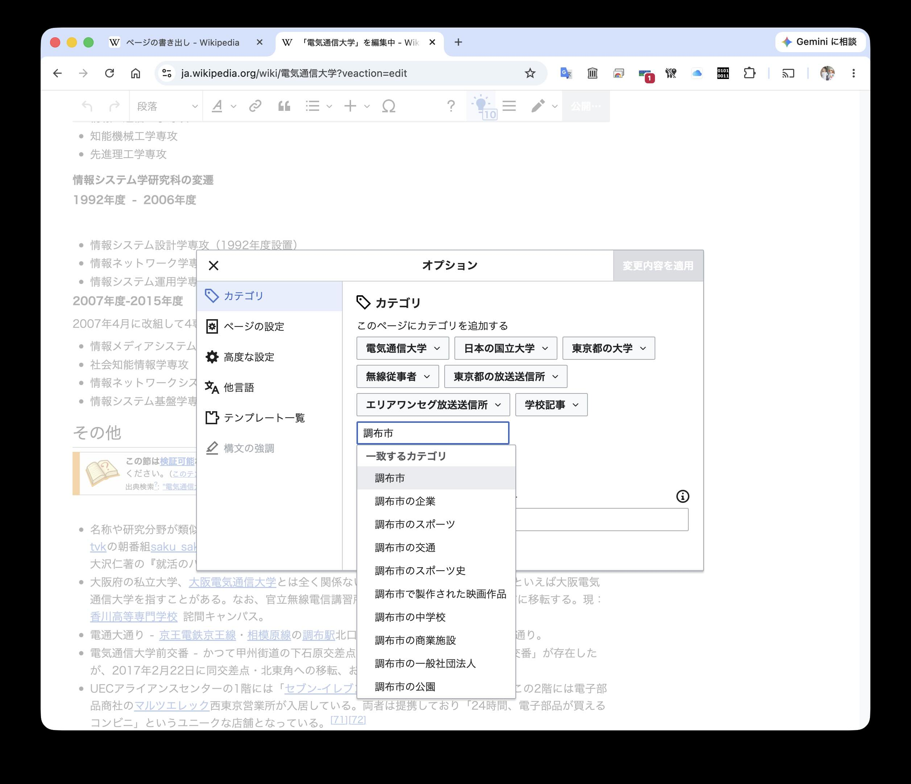
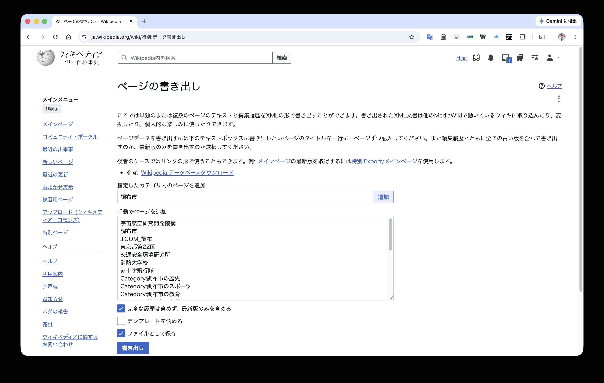

<style>
.marker {
  background: #fff59d;
  padding: 0 0.15em;
}
</style>

# 電気通信大学 メモ (1)

### 2026-11-05
### 梅本聖 

- この原稿の保管場所 https://hijiri.umemoto.org/
- 自己紹介 https://ja.wikipedia.org/wiki/%E5%88%A9%E7%94%A8%E8%80%85:Hijiri

---
# もくじ

- [1. ウィキペディアからローカル（メディアウィキ）にコンテンツをインポートする方法](#1-ウィキペディアからローカルメディアウィキにコンテンツをインポートする方法)
- [2. エディタソンの準備と運営について](#2-エディタソンの準備と運営について)
- [3. エディタソン運営チェックリスト](#3-エディタソン運営チェックリスト)
- [4. リレー式計算機に関する質問](#4-リレー式計算機に関する質問)

---

# 1. ウィキペディアからローカル（メディアウィキ）にコンテンツをインポートする方法

例として、ウィキペディア日本語版からローカル環境（ノートPCなど）へ、地域の情報（調布市にまつわる事物）のコンテンツだけを一括してコピーする方法を説明します。

### 手順の概要
1. ウィキペディアの記事に適切なカテゴリを追加する。（「調布市」など）
2. カテゴリをキーとして、ウィキペディアの記事をまとめてエクスポート＆ダウンロードする。 （XMLファイル）
- URL https://ja.wikipedia.org/wiki/%E7%89%B9%E5%88%A5:%E3%83%87%E3%83%BC%E3%82%BF%E6%9B%B8%E3%81%8D%E5%87%BA%E3%81%97
3. XMLファイルをローカルのメディアウィキ・サーバにインポートする。
---
### ウィキペディアの記事にカテゴリを追加する。

記事の編集画面から、適切なカテゴリを追加します。




---
### 記事の一括エクスポート

カテゴリをキーとして、記事を一括してエクスポート（ダンプ）することができます。エクスポートする記事は、個別に選択することも可能。

- URL https://ja.wikipedia.org/wiki/%E7%89%B9%E5%88%A5:%E3%83%87%E3%83%BC%E3%82%BF%E6%9B%B8%E3%81%8D%E5%87%BA%E3%81%97



---
### ダンプされたXMLファイルの中身（部分）
```
  <sha1>jg2tnthl3dy2mfnqd4omyttdre7lycs</sha1>
    </revision>
  </page>
  <page>
    <title>電気通信大学</title>
    <ns>0</ns>
    <id>25415</id>
    <revision>
      <id>111654698</id>
      <parentid>111217331</parentid>
      <timestamp>2026-11-05T14:26:29Z</timestamp>
      <contributor>
        <username>Hijiri</username>
        <id>5</id>
      </contributor>
      <minor/>
      <origin>111654698</origin>
      <model>wikitext</model>
      <format>text/x-wiki</format>
      <text bytes="57259" sha1="o4wq3sg2ioinp1jgx5r1q2nicr3nb6e" xml:space="preserve">{{Otheruses|東京都の大学|大阪府の大学|大阪電気通信大学}}
{{日本の大学
|ロゴ = UEC logo.svg
|画像 = The University of Electro-Communications gate.jpg
|画像説明 = 正門（2021年3月）
|大学設置年 = [[1949年]]
|創立年 = [[1918年]]
|学校種別 = 国立
|設置者 = [[国立大学法人|国立大学法人電気通信大学]]
|本部所在地 = [[東京都]][[調布市]][[調布ケ丘]]一丁目5番1号
|緯度度 = 35 |緯度分 = 39|緯度秒 = 21.9 |N(北緯)及びS(南緯) = N
|経度度 = 139 |経度分 = 32 |経度秒 = 38.6 |E(東経)及びW(西経) = E
|学部 = 情報理工学域
|研究科 = [[情報理工学研究科]]
|ウェブサイト = https://www.uec.ac.jp/
}}
'''電気通信大学'''（でんきつうしんだいがく、{{Lang-en|The University of Electro-Communications}}）は、[[東京都]][[調布市]]の[[国立大学]]。[[大学の略称|略称]]は'''電通大'''、'''UEC'''。

== 概観 ==
=== 大学全体 ===
[[File:uec_koudou.jpg|thumb|講堂]]
1918年に社団法人電信協会に無線電信講習所が設立されたことが起源である。
その創立経緯から当初は電気通信に関する研究教育が中心であったが、電子工学、機械工学に分野を広げ&lt;ref group="注"&gt;「電気通信」と呼ばれていた分野が、今日の「電子情報通信」を含むことは、[[電子情報通信学会]]の変遷からも明らかであろう。&lt;/ref&gt;、今日では情報通信分野に重点がある工学系の単科大学である点が特徴的である。

```
---
## XMLダンプのインポート

### ブラウザから行う場合は、次のURL

- http(s)://ホスト名:ポート番号/特別:インポート

### スクリプトを使う場合は、メディアウィキのマニュアルを参照

- https://www.mediawiki.org/wiki/Manual:Importing_XML_dumps/ja
---
# 2. エディタソンの準備と運営について

エディタソンを行う場合の事前準備や注意点については、つぎのリンクをご参照ください。

- https://ja.wikipedia.org/wiki/%E5%88%A9%E7%94%A8%E8%80%85:Hijiri/%E3%82%A6%E3%82%A3%E3%82%AD%E3%83%9A%E3%83%87%E3%82%A3%E3%82%A2%E3%83%BB%E3%82%A8%E3%83%87%E3%82%A3%E3%82%BF%E3%82%BD%E3%83%B3_%E9%96%8B%E5%82%AC%E3%83%BB%E9%81%8B%E5%96%B6%E3%81%AE%E6%89%8B%E5%BC%95%E3%81%8D

なお、ウィキペディアのサーバは、IPアドレスによるアクセス制限を行っています。たとえば、1つIPアドレスで作成できる新規アカウントの数は、日本語版ウィキペディアでは24時間で6個までに限られています。また、大学や公共機関、携帯電話のIPアドレス・ブロックがまとめてアクセス制限の対象となっていることがあります。

このため、プロキシサーバやNATでグローバルIPアドレスを共有している大学や企業などでは、アカウント作成や編集に支障が出ることがあります。

主催者スタッフのウィキペディア・アカウントに、「アカウント作成者」または「イベント主催者」の権限を付与することで、このような問題を回避できることがあります。詳しくは、下記リンク先をご確認ください。申請から権限の付与まで、概ね _2週間以上_ の処理期間です。

- https://ja.wikipedia.org/wiki/Wikipedia:アカウント作成者
- https://ja.wikipedia.org/wiki/Wikipedia:イベント主催者

---
# 3. エディタソン運営チェックリスト

エディタソンの運営で使えるチェックリストは、以下のリンク先にあります。

- https://ja.wikipedia.org/wiki/%E5%88%A9%E7%94%A8%E8%80%85:Hijiri/%E3%82%A8%E3%83%87%E3%82%A3%E3%82%BF%E3%82%BD%E3%83%B3%E9%81%8B%E5%96%B6%E3%83%81%E3%82%A7%E3%83%83%E3%82%AF%E3%83%AA%E3%82%B9%E3%83%88

---
# 4. リレー式計算機に関する質問

リレー式計算機を見て気になったことがあるのですが、ゼロで除算するとどうなりますか？

機械式計算機だと、永遠に集束しないで計算し続けるものがあるそうです。


<br/>
☎︎ おわり ☎︎

