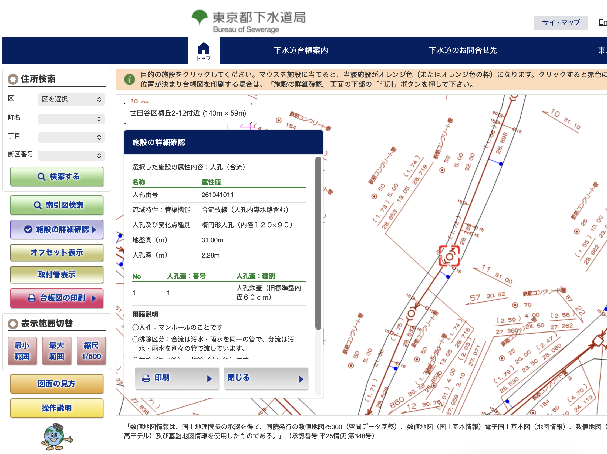
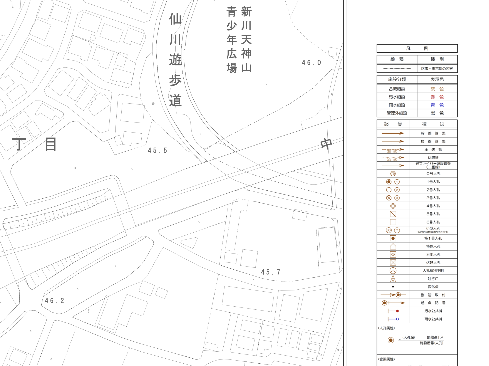
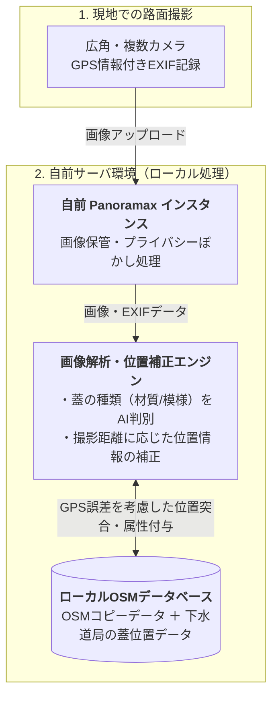

<style>
.marker {
  background: #fff59d;
  padding: 0 0.15em;
}
</style>

# マンホールのフタの画像を地図にマッピングしたい (1)

* Hijiri UMEMOTO
* 2026-11-15

---

# 1. プロジェクトの目的
* 市営下水道が管理する **マンホール（洞道、人孔）の蓋の種類（材質・模様など）** を地図上にマッピングする。

### 解決すべき課題
蓋の設置位置を示した地図データ（下水道台帳のデータ）は存在するが、「どの位置にどの種類の蓋が設置されているか」という属性情報が紐づいていない。

---
## (参考)東京都下水道局のオンライン版・下水道台帳


---
## 調布市の下水道台帳
### 蓋の情報が登載されていない。

---

# 2. システム選定の方針（OSMの活用）
* **OpenStreetMap（OSM）の採用:** 地図情報のオープンなライセンス体系やAPIアクセスの条件を考慮すると、OSMの基盤を利用するのが最適である。(Google Mapと比較して利用しやすい。)
* **OSMの制約と対策:**
  * OSM自体は画像データのストレージ機能を持たないため、外部システムまたは自前システムと連携させる必要がある。
  * OSM公式APIを通じた自動編集（AIによる一括書き込み等）は規約で禁止されている。
  * ネットワーク負荷や計算資源を抑え、画像認識AIによる自動判別・マッピングを効率よく行うため、**OSMからコピー（キャッシュ）したデータをローカルサーバに保存**して処理を行う構成が望ましい。

---

# 3. 画像マッピングシステムの比較と選定
位置情報付き画像をアップロードすると、プライバシー処理（顔やナンバープレートのぼかし）と地図上へのマッピングを自動で行うプラットフォームとして、主に以下の候補がある（※いずれも被写体の詳細なタグ付けは手動または独自処理が必要）。

## Mapillary / KartaView（商用ベースのサービス）
* **メリット:** 既存のインフラを利用でき、OSMを通じたデータ利用は認められている。
* **デメリット・制約:**
  * ライセンスはCC BY-SAだが、利用規約によりスクレイピング禁止やAPIアクセス・データ利用の制限がある。
  * アップロード後のバッチ処理完了まで、数時間〜数日のタイムラグが発生する。
  * 専用スマホアプリでは下向きアングルの撮影に対応していない。
  * **システム上の制約**により、複数カメラによる同時撮影データの統合・アップロードに対応していない。

---

## Panoramax（オープンソース・分散型システム）
* **特徴:** マストドン（Mastodon）のように複数のサーバ（インスタンス）が連携してデータを交換する仕組みを持つ。
* **活用事例:** 「特定の地域」「図書館」「グルテンフリー飲食店」など、テーマや対象物を絞った独自インスタンスが多く運用されている。
* **メリット:** 比較的容易に自前サーバを構築でき、商用サービスの制約や処理待ち時間に縛られず柔軟に運用できる。

# システム構成の提案とデータ連携フロー

画像のアップロード、プライバシー処理、およびマッピング基盤として、**自前で「Panoramax」のインスタンスを立ち上げて運用する**場合。



# 4. 利用する情報リソース
* **地図・位置データ:** OSMの道路データ ＋ 下水道台帳のデータ（任意開示や情報公開請求などで取得した蓋の位置情報; CVS, XML など）。
** 下水道台帳は、現時点で下水道局での閲覧、プリントアウト、PDFダウンロードでのみ提供されている。
* **画像データ:** 路上（自動車・自転車・徒歩）から下向き〜やや下向き、かつ広角で撮影した路面写真。

---
# 5. 撮影手法と機材・車両等の要件

## 撮影手法の選択肢
マンホールの蓋は路面上にあり遠くからの視認性が低いため、高頻度・高密度な撮影が必要となる。

1. **動画撮影（フレーム抽出）:** 取りこぼしが少ない。ただし、長時間の撮影や高解像度・高FPS設定にすると画像処理の負荷が高くなり、商用AIを利用する場合はコストが嵩む可能性がある。
2. **一定距離ごとの連続撮影（インターバル撮影）:** MapillaryやKartaViewで一般的な手法。路面の蓋を確実に捉えるには、**0.5m〜1mごと**といった極めて短い間隔での撮影が必要。
3. **一定時間ごとの連続撮影:** 移動手段（徒歩・自転車・自動車）の速度に応じて、**1秒間に数コマ**のペースで撮影する必要がある。

---
## カメラ機材の要件
* **画角・台数:** 広角レンズを使用するか、**複数台のカメラを用いて広い範囲を同時に撮影**する（自前のPanoramaxインスタンスであれば柔軟に運用可能）。
* **設置角度（仰角）:** 路面上の蓋の模様や材質がはっきりと判別できるよう、カメラの仰角はマイナス（**やや下向き、または真下**）に設定する。
* **稼働性能:** 長時間の連続撮影に耐えうる**十分なストレージ容量とバッテリー駆動時間**を備えていること。
* **位置情報の記録:** 撮影時の**GPS情報をEXIFデータに正確に記録**できること。

---
## 移動手段（徒歩・車両等）の要件
* **徒歩の場合:** カメラの**地上高と仰角を常に一定に保持**できること（専用ハーネスやジンバル、台車などの活用）。
* **車両（自動車・自転車等）の場合:**
  * 路面の凹凸による振動を抑え、**カメラの地上高・仰角を安定して固定**できるマウント機構を備えていること。
  * 走行速度に応じた適切なシャッタースピード（ブレ防止）および撮影間隔を確保できること。
  * 車体の一部や影が画角に大きく映り込まない位置へ設置できること。
  * 安全対策 (低い位置に突起物を取り付けないなど。道路交通法40条、57条など)

---
# 6. 画像処理・マッピングにおける技術的課題

### 1. 撮影アングルに応じた位置情報の補正
* **課題:** 斜め前方から撮影した写真の場合、「カメラのGPS座標（撮影地点）」と「実際に蓋がある座標（被写体地点）」にズレが生じる。
* **対策:** カメラの地上高・仰角・画角から撮影距離を計算し、位置情報を補正する処理が必要となる（海外で先行研究あり）。**できるだけ真上から撮影するほど、この補正値は小さく抑えられる。**

---

```text
【撮影角度による位置ズレの違い】

  [斜め前からの撮影]                     [真上からの撮影]
     📷 カメラ（GPS記録地点）                📷 カメラ（GPS記録地点）
      ＼                                      ｜
       ＼  ← 距離に応じた位置補正が必要        ｜ ← 補正値が最小限で済む
        ↘                                     ↓
  =======◎======= 路面（実際の蓋の位置）  =======◎======= 路面（実際の蓋の位置）
```

---
## 2. 既存の蓋位置データとの突合（GPS誤差の吸収）
* **課題:** 撮影機器で記録されるGPS情報には、周囲の建物や環境により**数十センチ〜数メートル程度の測定誤差**が必ず生じる。
* **対策:** 下水道局から入手した「既存の蓋の位置情報（正解座標）」と、画像から検出した蓋の位置を単純な座標一致ではなく、**一定の誤差範囲を許容した空間的な突合（マッチング）アルゴリズム**を用いて紐づける必要がある。

# 7. その他

## 成果物の公開
* 成果物（出来上がったデータ）を公開して、オープンデータとする。
** OSMへ情報を還元することで、OSM界隈と仲良くしよう。

## 著作権
* 画像ファイルの保管場所は、日本国内のサーバが望ましい。
** デザインマンホールについて、外国では著作権によって利用の制限がおよぶ可能性が排除できない。（cf. 日本の著作権法46条）

## マンホールの蓋をマッピングする事業の先行事例
* 「マンホール聖戦　全国出陣祭り -- 鉄とコンクリートの守り人」 https://prtimes.jp/main/html/rd/p/000000008.000079512.html
** OSMを使っているが、成果物（蓋の位置情報）がOSMに還元されていない。
** このプロジェクトを主催した Whole Earth Foundation（WEF）は、OSM界隈ではすこぶる評判が悪い。(2026年11月13-14日、OSM-JP関係者およびコントリビュータへの聞き取り。)

## 東京都下水道局の事例
* 下水道の人孔の蓋の位置と種類の詳細については、行政情報として公開されています。
** https://www.gesuijoho.metro.tokyo.lg.jp/semiswebsystem/SuperaPageWeb.aspx

## セキュリティ
* 重要な公共インフラ(通信線路など)との共同溝の場合、蓋の情報の公開範囲を制限する必要があるか。

(以下余白)
